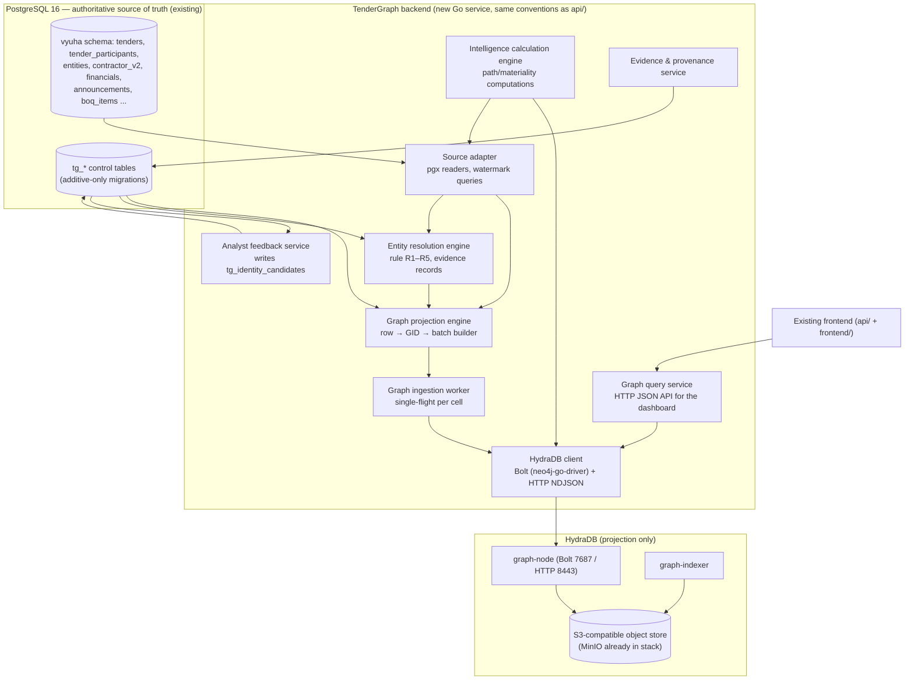

# ARCHITECTURE.md — TenderGraph system architecture (Phase 0 proposal)

Constrained by verified facts: Go + stdlib-HTTP + pgx is the existing backend convention
(PROJECT_AUDIT.md §3); no message broker, scheduler, or container manifest exists in this
repo; HydraDB speaks Bolt (Neo4j drivers) and HTTP with auto-commit writes and 1024-item
UNWIND batches; PostgreSQL is authoritative and shared with another live system.

## 1. Component diagram



## 2. Components

### 2.1 PostgreSQL source adapter
- **Responsibility**: read-only SELECTs over source tables, partitioned by PK watermarks;
  exposes typed row batches. Reuses `internal/db` `Connect` and `srv.Query` patterns.
- **Input**: table name + watermark (`tg_projection_watermark`).
- **Output**: typed Go structs / row maps per entity.
- **Dependencies**: pgx pool (new pool with low connection cap to protect the shared DB).
- **Error handling**: per-batch retry with backoff; query timeouts; never writes.
- **Testing**: integration tests against a disposable schema mirror; recorded-SQL unit tests.

### 2.2 Graph projection engine
- **Responsibility**: transform source rows into node/edge records per DATA_MAPPING.md:
  apply `sqlf` normalization/money/FY rules, compute GIDs, build UNWIND batches (≤1000 rows),
  maintain `tg_projection_watermark` and idempotency keys.
- **Input**: adapter row batches. **Output**: Cypher batches + control-table updates.
- **Dependencies**: source adapter; HydraDB client (for batch dispatch); `sqlf` package.
- **Error handling**: batch-level failure records in `tg_projection_batches` (status,
  error, retry_count); collision on GID hash aborts the batch (never merges two entities).
- **Testing**: golden-file tests (row → expected Cypher + params); reconciliation job
  comparing projected counts vs PostgreSQL counts vs `vw_vyuha_l1_intelligence` aggregates.

### 2.3 Entity resolution engine
- **Responsibility**: execute rules R1–R5 (GRAPH_ONTOLOGY.md §4) over PostgreSQL data,
  emit `tg_identity_candidates` rows with evidence; never writes directly to the graph.
- **Input**: entities/aliases/entity_gst/contractor_v2/tender_participants rows.
- **Output**: candidate pairs + `tg_evidence` rows; CONFIRMED/REJECTED transitions **only from
  analyst actions** — no rule combination (R1+R2, R1+R3, or any dual rule) auto-confirms, and
  GSTIN equality (R3) is candidate evidence only that must never serve as the second
  confirming rule (GRAPH_ONTOLOGY.md §4, DECISIONS D6).
- **Dependencies**: source adapter; existing `api/internal/repo` mapping CTEs (reused).
- **Error handling**: ambiguous pairs are preserved as multiple CANDIDATEs (dashboard
  `ambiguous` semantics); no silent merges by construction.
- **Testing**: golden tests reproducing the dashboard's MATCHED/AMBIGUOUS/UNRESOLVED
  partition on the current dataset (89 mapped FE, 391 mapped awards — README).

### 2.4 HydraDB client
- **Responsibility**: Bolt sessions (neo4j-go-driver) + HTTP JSON/NDJSON fallback; batch
  sender, bookmark capture, typed-cell decoding (`.get("value")` rule, 422-envelope guard,
  vertex_id-not-integer handling — all verified behaviors), pagination loop, cancellation.
- **Input**: batch requests. **Output**: results/bookmarks/errors.
- **Dependencies**: none beyond the driver; token from env (`HYDRADB_*`).
- **Error handling**: classify parse/limit/budget errors; `resource_exhausted` →
  halve batch; transient network → retry whole batch (all writes idempotent MERGEs).
- **Testing**: contract tests against a local disposable graph-node (Phase 1 spike).

### 2.5 Graph ingestion worker
- **Responsibility**: run projection phases in dependency order (DATA_MAPPING.md §order);
  labels-first per batch; single writer (HydraDB leases admit one writer per cell anyway);
  expose CLI subcommands (`backfill`, `sync`, `verify`) mirroring `api/cmd/` conventions.
- **Input**: projection batches. **Output**: committed batches + bookmarks.
- **Error handling**: resume from last watermark; failed batches recorded, never skipped.
- **Testing**: end-to-end test against a scratch HydraDB store + scratch PG schema.

### 2.6 Incremental synchronization
- **Mechanism**: watermark-based polling (initially a CLI command run on a schedule; the
  repo has no scheduler to reuse — that is a Phase-1 decision, not assumed).
- **No broker**: no Kafka/RabbitMQ/Debezium is introduced; there is no existing broker in
  this repo to reuse (a `~/rabbitmq` directory belongs to the user's other work, not this
  app). If the scraper system later exposes CDC, the adapter interface stays unchanged.
- **Latency model**: minutes (poll interval), not seconds; the graph is explicitly a
  projection, and freshness SLAs are documented per entity.
- **Per-table strategy** (schema-verified timestamp facts: **every sync-candidate table has
  `created_at`; `updated_at` is missing only in `entity_aliases`, `announcements_raw`,
  `company_events`; `tender_announcement_matches` has `reviewed_at` instead of a generic
  status timestamp**). Mutable/append-only classification is **PROPOSED** from schema +
  domain behavior and must be confirmed against live update traffic in Phase 1:

| Source table | PK | Class (proposed) | Change field (verified) | Watermark strategy | Update detection | Delete detection |
|---|---|---|---|---|---|---|
| `tenders` | `id int` | mutable | `updated_at` | `(updated_at, id)` + bounded lookback | lookback re-read | reconciliation |
| `tender_extracted_meta` | `id int` | mutable | `updated_at` | `(updated_at, id)` + lookback | lookback re-read | reconciliation |
| `tender_participants` | `id int` | mutable (statuses backfill) | `updated_at` (+ `technical_status_updated_on`, `financial_status_updated_on`) | `(updated_at, id)` + lookback | lookback re-read | reconciliation |
| `contractor_v2` | `id int` | mutable | `updated_at` | `(updated_at, id)` + lookback | lookback re-read | reconciliation |
| `entities` | `id uuid` | mutable | `updated_at` | `(updated_at, id)` + lookback | lookback re-read | reconciliation |
| `entity_aliases` | `id uuid` | append-mostly | `created_at` only (**no `updated_at`**) | `(created_at, id)`; full re-projection is cheap | none (rows treated immutable) | reconciliation |
| `entity_gst` | `id bigint` | mutable | `updated_at` | `(updated_at, id)` + lookback | lookback re-read | reconciliation |
| `entity_financials` | `id bigint` | mutable (restatements) | `updated_at` | `(updated_at, id)` + lookback | lookback re-read | reconciliation |
| `entity_quarterly_financials` | `id bigint` | mutable | `updated_at` | `(updated_at, id)` + lookback | lookback re-read | reconciliation |
| `entity_market_data` | `id bigint` | append-only time series | `created_at` | monotonic PK `MAX(id)` | none (immutable snapshots) | reconciliation |
| `announcements_raw` | `id bigint` | append-only | `created_at` only (**no `updated_at`**) | monotonic PK `MAX(id)` | none | reconciliation |
| `company_events` | `id bigint` | append-only | `created_at` only (**no `updated_at`**); 0 rows today | monotonic PK `MAX(id)` | none | reconciliation |
| `tender_announcement_matches` | unique `(tender_id, announcement_id)` | mutable (status) | `reviewed_at` | **full re-projection each sync** (low-volume) | full re-read | reconciliation |
| `boq_items` | `id int` | mutable (awardee fields backfilled after award) | `updated_at` | `(updated_at, id)` + lookback | lookback re-read | reconciliation |
| `seller_details` | `id uuid` | mutable | `updated_at` | `(updated_at, id)` + lookback | lookback re-read | reconciliation |
| `tg_*` control tables | per-table | mutable, low-volume | `created_at`/`reviewed_at` | full re-projection or `(updated_at, pk)` | full re-read | control tables are authoritative — never delete |

- A simple `MAX(id)` checkpoint is used **only** for verified append-only tables; mutable
  tables always use a composite timestamp+PK watermark **plus a bounded lookback window**
  (re-read rows newer than the watermark minus N hours) because `(updated_at, id)` alone can
  miss rows whose `updated_at` was committed after the watermark read but with an older
  timestamp value (late-committing transactions).
- **Deletes**: no source table exposes tombstones. Deletion detection is reconciliation-based
  (§6): source PK sets are compared against projected `gid` sets per type. Whether a detected
  deletion tombstones the node (`src_deleted=true`), unlinks it, or removes it depends on
  HydraDB delete behavior, which is **runtime-unverified** — a Phase-1 decision after the
  smoke test, not assumed here. Source rows are never modified.
- **Batch semantics (authoritative ordering — replay-safe, idempotent, at-least-once; no
  exactly-once claim)**:
  1. Read a stable source batch (single committed snapshot; `MAX(id)`/`(updated_at,id)`
     bounded, ORDER BY key).
  2. Project rows → node/edge records (GID, properties, labels).
  3. Write to HydraDB (labels-first node batch, then edge batch).
  4. Verify the graph write (bookmark/count check — §3) before any checkpoint move.
  5. Mark the projection batch SUCCEEDED in `tg_projection_batches`.
  6. Advance the checkpoint **only after** step 5.
  - Crash after step 3 but before step 5/6 ⇒ checkpoint unchanged; the retry replays the
    same deterministic ids/edge keys and is harmless (idempotent upserts).
  - Partial graph write ⇒ batch FAILED, checkpoint unchanged, full batch replay.
  - Duplicate retry ⇒ collapsed by deterministic ids (nodes) and row-keyed edges; for
    multi-observation facts the `CoBidObservation` node strategy keeps distinct observations
    distinct (DECISIONS D12).
  - Late-committing source transaction ⇒ covered by the lookback window.
  - Updated existing row ⇒ caught by the `(updated_at, id)` watermark on re-poll.
  - Deleted source row ⇒ reconciliation (above), not the watermark path.
  - Schema drift ⇒ adapter SELECTs fail fast (§5).
  - HydraDB unavailability ⇒ worker backs off; checkpoint never advances past unprojected
    records.

### 2.7 Graph query service
- **Responsibility**: HTTP JSON endpoints (`/api/v1/graph/*`) translating dashboard queries
  to the verified Cypher subset; enforces whitelist-style input handling like `repo.Sorts`;
  handles unsupported WHERE operators by fetching candidates via PostgreSQL ids and querying
  the graph by id.
- **Dependencies**: HydraDB client; existing server scaffolding (`srv.Server` pattern).
- **Testing**: golden query tests; budget-bound traversal tests (never unbounded).

### 2.8 Intelligence calculation engine
- **Responsibility**: contract-to-capital ratios, bidder-network metrics, price-intelligence
  aggregates. Uses `algo.SPpaths/SSpaths/MSpaths/degree` for structure, PostgreSQL for
  arithmetic-heavy aggregations (HydraDB RETURN has no arithmetic — verified).
- **Testing**: property-based checks against view-derived baselines. Bidder-network metrics
  derive **only from `tender_participants` rows** plus supported identity links — never from
  `tenders.contractor_v2_id` (a contractor-of-record assignment is not bid participation;
  GRAPH_ONTOLOGY.md §2, DECISIONS D10). Co-bid observations are `CoBidObservation` nodes
  (one per tender per pair), so per-tender evidence and repeat counts stay computable.

### 2.9 Evidence & provenance service
- **Responsibility**: persist `tg_evidence` rows; attach evidence GIDs to every derived
  edge; expose evidence lookups.
- **Testing**: every `WON`/`IDENTIFIED_AS`/`MATCHED_TO` edge must resolve to ≥1 evidence row
  (enforced by a reconciliation test).

### 2.10 Analyst feedback service
- **Responsibility**: accept identity/match decisions (CONFIRM/REJECT with notes), write to
  `tg_identity_candidates` / `tender_announcement_matches` (reviewed_by/reviewed_at), and
  project status changes into the graph.
- **Note**: **no authentication layer exists in the API (verified).** Analyst write endpoints
  are therefore **blocked** — they are not shipped as part of the initial read-only graph
  API. Phase 1 must deliver an approved authentication *and* authorization design first. An
  API key may serve as a temporary operational control, but it is **not** equivalent to a
  complete user authorization model and must not be documented as one. Until then, identity
  transitions happen only via direct PostgreSQL access by analysts/ops (audited by
  `reviewed_by`).

## 3. Data flow (backfill and sync share the same shape)

```
1. READ     PostgreSQL row batch for watermark W (stable snapshot, ORDER BY key)
2. PROJECT  rows → GIDs + properties + labels + edge records
3. WRITE    HydraDB: UNWIND node batch (MERGE + SET label)      [bookmark B1]
            UNWIND edge batch   (MERGE/CREATE)                  [bookmark B2]
4. VERIFY   count query at bookmark B2 vs expected batch size
5. RECORD   tg_projection_batches SUCCEEDED
6. ADVANCE  checkpoint → W   (only after step 5)
```

Failure at any step ⇒ batch marked FAILED, **watermark unchanged** (the checkpoint never
advances past unprojected records), and the rerun re-executes the same deterministic
upserts. The baseline is **replay-safe, idempotent, at-least-once** projection — an
exactly-once guarantee is **not** claimed and would require a transactional sink to prove.
Bookmark-based read-your-writes is documented HydraDB behavior but is **runtime-unverified**
until the smoke test (spike/hydradb_smoke.md) passes; the verification step above must not
be assumed to work until then.

## 4. Deployment architecture

- **Dev**: `graph-node` process (plaintext, local directory store) + this Go service
  (`go run ./graph/cmd/tgsync`) + existing api/frontend untouched.
- **Prod target**: HydraDB behind TLS with an S3-compatible store — MinIO already deployed
  in this stack (`MINIO_*` config verified in `api/.env`), so object-store prerequisites
  exist; a dedicated bucket (e.g. `vyuha-graph`) would be created by the operator.
- **Packaging**: single Go module addition (`graph/` directory in this repo); no new
  language/framework (per fixed decisions and repo conventions). Docker images deferred —
  the repo has none today; document run commands instead.

## 5. Failure handling

| Failure | Behavior |
|---|---|
| HydraDB unavailable | sync worker stops with retry/backoff; PostgreSQL unaffected; API degrades to existing PostgreSQL-only endpoints |
| Batch rejected (parse/limit) | recorded FAILED with error; batch halved on `resource_exhausted`; no partial watermark advance |
| Node crash mid-sync | resume from watermark; deterministic upserts make replays safe (at-least-once) |
| Partial graph write | batch FAILED, checkpoint unchanged, full batch replay (idempotent) |
| Late update to an existing source row | caught by the `(updated_at, id)` composite watermark on re-poll; lookback window covers late-committing transactions |
| Deleted source row | no tombstone in sources — detected by reconciliation (§6); handling decided in Phase 1 after HydraDB delete behavior is runtime-verified |
| GID hash collision | batch aborts loudly; pre-write check confirms existing node's `gid` matches; pair logged; versioned re-key (`id_algo_v`) — never a silent merge |
| Schema drift in source DB | adapter SELECTs fail fast; reconciliation job alerts |
| Indexer outage (HydraDB) | reads stay correct via WAL overlay/canonical fallback (verified architecture) — no action needed |

## 6. Consistency model

- PostgreSQL is always truth; the graph is a possibly-stale read-optimized projection.
- Writes: auto-commit per batch; read-your-writes inside a sync run via bookmarks
  (**documented** HydraDB behavior, not yet runtime-verified — spike/hydradb_smoke.md).
- Reads from the graph use documented consistency modes; `strong`/bookmark-pinned reads are
  used sparingly for verification queries (object-store round trip per call — documented
  cost). No claim is made that every graph read is immediately consistent with every
  preceding write; freshness is bounded by the sync interval plus indexer lag.
- **Reconciliation** (runs after every sync; correctness check, not just counts):
  1. Missing nodes: per-label `gid` set vs source PK set (sampled or full for small types).
  2. Missing edges: per-type `(src_gid, dst_gid)` count vs FK-join counts in PostgreSQL.
  3. Stale properties: `synced_at_ms` vs watermark age per node; sample property comparison.
  4. Deleted source records: projected gids whose source PK no longer exists.
  5. Duplicate projections: duplicate `gid` values (must be zero; numeric-id upsert makes
     duplicates a bug signal) and duplicate row-keyed edges.
  6. Unresolved source references: FKs pointing at rows with no projected node (e.g.
     `announcements_raw.entity_id` to a missing entity).
  - Simple node-count equality is **necessary but not sufficient** — per-type edge counts
    and gid-set checks are required. Discrepancies surface as FAILED verification, not
    silent drift. Label-coverage rule (labels in node batches) keeps label-anchored counts
    complete (verified HydraDB caveat).

## 7. Security boundaries

- **PostgreSQL permission model (recommended: Option B — one narrowly scoped service role)**
  — the earlier "separate read-only role" recommendation was internally inconsistent, since
  the service must also write the `tg_*` control tables:
  - **Option A (two roles)**: `tg_reader` (SELECT on source tables/views) +
    `tg_control_writer` (INSERT/UPDATE/SELECT on `tg_*` only). Stronger blast-radius
    separation, but two credential sets and more provisioning surface.
  - **Option B (recommended, one service role)**: `tendergraph_svc` with SELECT on the
    explicitly enumerated source tables/views used by the projection, plus
    INSERT/UPDATE/SELECT on the explicitly approved `tg_*` control tables, and **no write
    permission of any kind on existing production source tables**. One credential, least
    privilege still holds, and the sync path matches how the code actually runs (read
    source → write control). Trade-off: a compromised service credential can both read
    source data and write control tables — mitigated by keeping the grant list enumerated
    (no schema-wide ALL) and by the fact that `tg_*` tables are additive-only and
    projection-internal.
  - **No roles are created or changed in Phase 0**; this is a design decision for the
    provisioning step (DECISIONS D14). The existing `prod` credentials in `api/.env`
    (gitignored) remain the operator's, not the service's.
- HydraDB bearer token in env (`HYDRADB_AUTH_TOKEN_FILE`), never logged (same convention as
  `DATABASE_URL`).
- Graph query service is read-only toward HydraDB in the API path; only the sync worker holds
  write-capable credentials.
- The dashboard frontend keeps using the existing API; **analyst write endpoints remain
  blocked** until an authentication and authorization design is approved (§2.10) — the graph
  API adds no new write surface.
