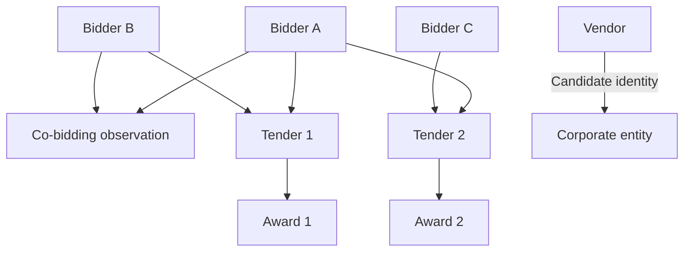
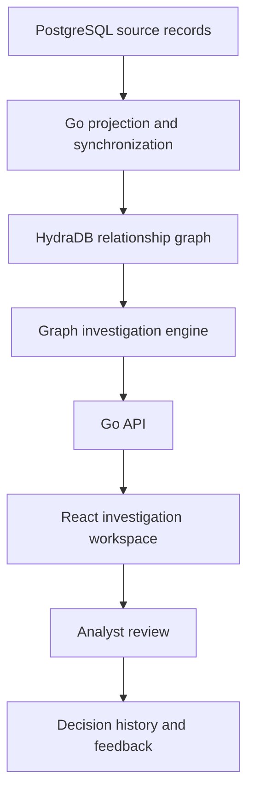

# TenderGraph

### Turning fragmented public procurement records into connected investigations.

India's public procurement system records how government departments, ministries, public sector undertakings and autonomous bodies spend public funds on goods, services and infrastructure works. Through platforms such as the Central Public Procurement Portal (CPPP), GeM and government e-procurement systems, the process generates records around **procuring organisations, tenders, bidders, submitted bids, technical and financial evaluations, contract awards, vendors and contract values**. 

However, procurement records are spread across organisations, portals and individual tender transactions. They do not provide investigators with a unified relationship view connecting the same bidders across tenders, recurring competition patterns or potential links between vendors and corporate entities.

<table>
  <tr>
    <td align="center">
      
    </td>
    <td align="center">
      
    </td>
  </tr>
</table>

**TenderGraph** addresses this analytical gap by using **HydraDB as its core graph engine** to connect fragmented procurement records into an explorable relationship network. Instead of treating every tender as an isolated transaction, HydraDB models the relationships between bidders, tenders, participation records, awards and corporate entities, enabling investigators to traverse connections across multiple procurement events. 
Users can identify recurring co-bidding patterns, examine how frequently bidders compete against one another, trace award relationships and explore potential corporate connections. Every observed relationship retains a link to its underlying source records, allowing investigators to move from a discovered pattern to the evidence behind it.

Built for **procurement auditors, vigilance and oversight teams, investigative journalists and public procurement researchers**, TenderGraph helps turn fragmented transaction records into evidence-backed investigative leads. It does not automatically declare fraud or collusion; it helps investigators discover patterns, examine the supporting evidence and decide what warrants further scrutiny.

## 1. The scale of procurement intelligence

We built a large-scale public procurement data collection pipelines from the ground up, 
Within just **24 hours, we collected over 26,000 tenders**, along with bidder participation, BOQ line items, award records and related procurement data. 

These records were normalized into a unified PostgreSQL dataset, then projected into **HydraDB**, which powers TenderGraph's relationship network and graph-based investigations. The collection process continues to evolve through an iterative feedback loop, using data-quality findings and gaps identified during analysis to improve subsequent extraction, coverage and the underlying graph.

Current dataset:
| Dataset                                       | Records |
| --------------------------------------------- | ------: |
| Tenders                                       |  26,125 |
| Bidder participation records                  |  22,865 |
| BOQ line items                                | 356,048 |
| Co-bidding observations                       |  78,201 |
| Named bidder pairs with shared tender history |  56,249 |
| Award records                                 |  20,329 |
| Evidence-backed winner relationships          |   3,927 |
| Corporate entities                            |   5,973 |
| Vendor–corporate GSTIN matches                |      45 |

### From records to investigative leads

When undergone analysis with tendergraph, we identified an 11-bidder recurring cluster in Department of Posts procurement.

Across 195 participant-covered awarded tenders involving this group, its members won 95 awards. One bidder had 14 recorded wins where its own bid, the field minimum and the awarded value matched exactly.

The analysis found a statistically significant association between bidder participation and winning outcomes (χ² = 29.8, p = 0.00091).

These observations provide a concrete starting point for investigation. 

2\. The HydraDB graph investigation engine

Procurement relationships do not exist in isolation. A bidder participates in multiple tenders, encounters other bidders, appears in award records and may have potential links to corporate entities.

TenderGraph models these relationships explicitly in HydraDB.

Rather than treating each tender as an isolated record, the graph makes it possible to follow connections across procurement activity and inspect the evidence behind each relationship.

### Graph model

A co-bidding observation is represented as its own graph node, connected to the two bidder records. This preserves the tender-specific context of the relationship rather than creating an unsupported direct connection between companies.

### What HydraDB enables

- **Multi-hop investigation:** traverse bidder relationships across multiple shared tenders.
- **Recurring relationship discovery:** identify bidders connected through repeated procurement observations.
- **Pair investigation:** inspect shared tender history, overlap and directional coverage.
- **Path discovery:** find bounded paths between bidders and other graph entities.
- **Evidence traversal:** follow graph relationships back to their source tenders, participant records and awards.
- **Corporate relationship exploration:** inspect potential vendor-to-company links without treating unverified matches as confirmed identities.

### Graph performance

Benchmark results across six investigation workloads, comparing native HydraDB queries, PostgreSQL queries and the Go application. Each workload was run for 30 samples; figures below are warm p50 latency.

| Investigation workload | PostgreSQL | HydraDB |
| --- | ---: | ---: | ---: |
| One-hop co-bidders | 77.43 ms | 1.179 ms | 
| Multi-hop, depth 2 | 45.10 ms | 2.282 ms | 
| Multi-hop, depth 3 | 45.08 ms | 4.359 ms | 
| Pair co-bidding history | 77.12 ms | 0.079 ms | 
| Corporate GST registrations | 62.49 ms | 0.225 ms |

everything here was ran on a home server having mere 8 gigs of ram and a 4 core 4 thread ryzen 3 3200g processor.

### Why HydraDB?

A procurement investigation often requires following relationships that span multiple tenders and bidders.

HydraDB provides a native graph execution layer for these investigations:

1. Start with a bidder.
2. Traverse its shared tender observations.
3. Discover other bidders connected through multiple tenders.
4. Follow those bidders into additional procurement relationships.
5. Inspect the tender and award evidence behind every connection.
6. Identify a pattern that was not obvious from an individual tender record.

The graph is not simply a visualization layer. It represents the relationship structure used by the investigation engine.

## 3. Core implementation

### Data architecture

**PostgreSQL — source of truth**

Stores original procurement records, bidder participation, awards, BOQ data, corporate financial information and analyst decisions. Original source records are not modified to construct the graph.

**Go — projection and investigation orchestration**

Handles deterministic graph projection, synchronization, candidate generation, investigation logic, graph algorithm execution and API responses.

**HydraDB — relationship engine**

Stores the rebuildable procurement graph and supports native relationship traversal, bounded path discovery and graph algorithms.

**React — investigation workspace**

Provides bidder search, network exploration, tender and company intelligence, evidence inspection and analyst review.

### Projection and provenance

Selected PostgreSQL records are projected into deterministic graph entities and relationships. Stable identifiers allow the graph to be rebuilt from source data.

Relationships preserve their source references and derivation context. Candidate identity matches remain distinct from analyst-confirmed relationships.

The graph includes:

- Tender and bidder entities.
- Shared tender observations.
- Vendor and corporate entities.
- Award relationships.
- Government organization relationships.
- GST registration and alias relationships.

### Analyst feedback loop

Analysts can review potential relationships, record decisions and provide evidence-backed feedback. Decisions are versioned and retained in an append-only history.

These decisions form the foundation for a versioned candidate-ranking system.

The current implementation provides analyst feedback infrastructure. Measured ranking improvement will be reported only after genuine analyst labels and held-out evaluation are available.

---

**TenderGraph turns fragmented procurement records into connected, traceable investigations — helping analysts move from individual transactions to relationships worth examining.**
