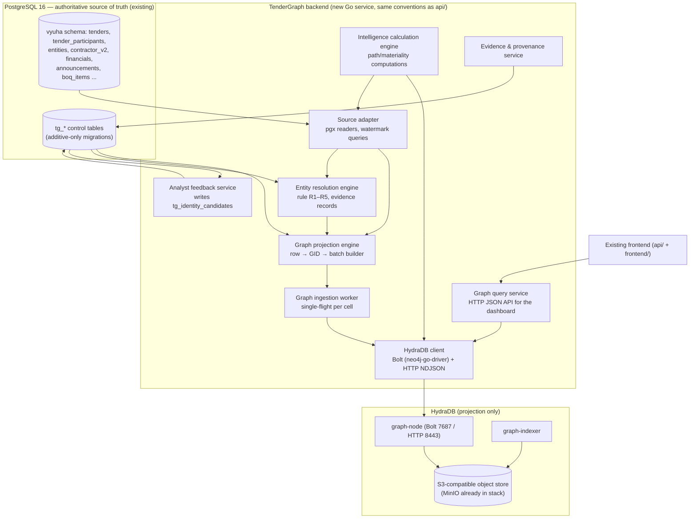

# ARCHITECTURE.md — TenderGraph system architecture (Phase 0 proposal)

Constrained by verified facts: Go + stdlib-HTTP + pgx is the existing backend convention
(PROJECT_AUDIT.md §3); no message broker, scheduler, or container manifest exists in this
repo; HydraDB speaks Bolt (Neo4j drivers) and HTTP with auto-commit writes and 1024-item
UNWIND batches; PostgreSQL is authoritative and shared with another live system.

## 1. Component diagram



## 2. Components

### 2.1 PostgreSQL source adapter
- **Responsibility**: read-only SELECTs over source tables, partitioned by PK watermarks;
  exposes typed row batches. Reuses `internal/db` `Connect` and `srv.Query` patterns.
- **Input**: table name + watermark (`tg_projection_watermark`).
- **Output**: typed Go structs / row maps per entity.
- **Dependencies**: pgx pool (new pool with low connection cap to protect the shared DB).
- **Error handling**: per-batch retry with backoff; query timeouts; never writes.
- **Testing**: integration tests against a disposable schema mirror; recorded-SQL unit tests.

### 2.2 Graph projection engine
- **Responsibility**: transform source rows into node/edge records per DATA_MAPPING.md:
  apply `sqlf` normalization/money/FY rules, compute GIDs, build UNWIND batches (≤1000 rows),
  maintain `tg_projection_watermark` and idempotency keys.
- **Input**: adapter row batches. **Output**: Cypher batches + control-table updates.
- **Dependencies**: source adapter; HydraDB client (for batch dispatch); `sqlf` package.
- **Error handling**: batch-level failure records in `tg_projection_batches` (status,
  error, retry_count); collision on GID hash aborts the batch (never merges two entities).
- **Testing**: golden-file tests (row → expected Cypher + params); reconciliation job
  comparing projected counts vs PostgreSQL counts vs `vw_vyuha_l1_intelligence` aggregates.

### 2.3 Entity resolution engine
- **Responsibility**: execute rules R1–R5 (GRAPH_ONTOLOGY.md §4) over PostgreSQL data,
  emit `tg_identity_candidates` rows with evidence; never writes directly to the graph.
- **Input**: entities/aliases/entity_gst/contractor_v2/tender_participants rows.
- **Output**: candidate pairs + `tg_evidence` rows; CONFIRMED/REJECTED transitions only from
  analyst actions or dual-rule corroboration (R1+R3).
- **Dependencies**: source adapter; existing `api/internal/repo` mapping CTEs (reused).
- **Error handling**: ambiguous pairs are preserved as multiple CANDIDATEs (dashboard
  `ambiguous` semantics); no silent merges by construction.
- **Testing**: golden tests reproducing the dashboard's MATCHED/AMBIGUOUS/UNRESOLVED
  partition on the current dataset (89 mapped FE, 391 mapped awards — README).

### 2.4 HydraDB client
- **Responsibility**: Bolt sessions (neo4j-go-driver) + HTTP JSON/NDJSON fallback; batch
  sender, bookmark capture, typed-cell decoding (`.get("value")` rule, 422-envelope guard,
  vertex_id-not-integer handling — all verified behaviors), pagination loop, cancellation.
- **Input**: batch requests. **Output**: results/bookmarks/errors.
- **Dependencies**: none beyond the driver; token from env (`HYDRADB_*`).
- **Error handling**: classify parse/limit/budget errors; `resource_exhausted` →
  halve batch; transient network → retry whole batch (all writes idempotent MERGEs).
- **Testing**: contract tests against a local disposable graph-node (Phase 1 spike).

### 2.5 Graph ingestion worker
- **Responsibility**: run projection phases in dependency order (DATA_MAPPING.md §order);
  labels-first per batch; single writer (HydraDB leases admit one writer per cell anyway);
  expose CLI subcommands (`backfill`, `sync`, `verify`) mirroring `api/cmd/` conventions.
- **Input**: projection batches. **Output**: committed batches + bookmarks.
- **Error handling**: resume from last watermark; failed batches recorded, never skipped.
- **Testing**: end-to-end test against a scratch HydraDB store + scratch PG schema.

### 2.6 Incremental synchronization
- **Mechanism**: watermark-based polling (initially a CLI command run on a schedule; the
  repo has no scheduler to reuse — that is a Phase-1 decision, not assumed). Change detection
  is PK/`updated_at` based:
  - append-mostly tables (`tenders`, `tender_participants`, `boq_items`, `announcements_raw`):
    watermark on PK.
  - updatable tables (`entities`, `contractor_v2`, `entity_financials`, `entity_market_data`,
    `tender_extracted_meta`): watermark on `updated_at` (+ PK tiebreak).
  - control tables (`tg_identity_candidates`, `tender_announcement_matches`): watermark on PK;
    analyst decisions are low-volume.
- **No broker**: no Kafka/RabbitMQ/Debezium is introduced; there is no existing broker in
  this repo to reuse (a `~/rabbitmq` directory belongs to the user's other work, not this
  app). If the scraper system later exposes CDC, the adapter interface stays unchanged.
- **Latency model**: minutes (poll interval), not seconds; the graph is explicitly a
  projection, and freshness SLAs are documented per entity.

### 2.7 Graph query service
- **Responsibility**: HTTP JSON endpoints (`/api/v1/graph/*`) translating dashboard queries
  to the verified Cypher subset; enforces whitelist-style input handling like `repo.Sorts`;
  handles unsupported WHERE operators by fetching candidates via PostgreSQL ids and querying
  the graph by id.
- **Dependencies**: HydraDB client; existing server scaffolding (`srv.Server` pattern).
- **Testing**: golden query tests; budget-bound traversal tests (never unbounded).

### 2.8 Intelligence calculation engine
- **Responsibility**: contract-to-capital ratios, bidder-network metrics, price-intelligence
  aggregates. Uses `algo.SPpaths/SSpaths/MSpaths/degree` for structure, PostgreSQL for
  arithmetic-heavy aggregations (HydraDB RETURN has no arithmetic — verified).
- **Testing**: property-based checks against view-derived baselines.

### 2.9 Evidence & provenance service
- **Responsibility**: persist `tg_evidence` rows; attach evidence GIDs to every derived
  edge; expose evidence lookups.
- **Testing**: every `WON`/`IDENTIFIED_AS`/`MATCHED_TO` edge must resolve to ≥1 evidence row
  (enforced by a reconciliation test).

### 2.10 Analyst feedback service
- **Responsibility**: accept identity/match decisions (CONFIRM/REJECT with notes), write to
  `tg_identity_candidates` / `tender_announcement_matches` (reviewed_by/reviewed_at), and
  project status changes into the graph.
- **Note**: no auth layer exists in the API yet; Phase 1 must decide (at minimum an API key
  or session) before this endpoint ships — flagged as an open decision.

## 3. Data flow (backfill)

```
PostgreSQL row batch (watermark W)
  → projection: GID + properties + label batch
  → HydraDB: UNWIND node batch (MERGE + SET label)      [bookmark B1]
             UNWIND edge batch   (MERGE/CREATE)         [bookmark B2]
  → verify:   MATCH count query with bookmark B2 vs batch size
  → control:  tg_projection_batches SUCCEEDED, watermark W
```

Failure at any step ⇒ batch marked FAILED, watermark unchanged, rerun re-executes the same
idempotent MERGEs (HydraDB upsert semantics verified).

## 4. Deployment architecture

- **Dev**: `graph-node` process (plaintext, local directory store) + this Go service
  (`go run ./graph/cmd/tgsync`) + existing api/frontend untouched.
- **Prod target**: HydraDB behind TLS with an S3-compatible store — MinIO already deployed
  in this stack (`MINIO_*` config verified in `api/.env`), so object-store prerequisites
  exist; a dedicated bucket (e.g. `vyuha-graph`) would be created by the operator.
- **Packaging**: single Go module addition (`graph/` directory in this repo); no new
  language/framework (per fixed decisions and repo conventions). Docker images deferred —
  the repo has none today; document run commands instead.

## 5. Failure handling

| Failure | Behavior |
|---|---|
| HydraDB unavailable | sync worker stops with retry/backoff; PostgreSQL unaffected; API degrades to existing PostgreSQL-only endpoints |
| Batch rejected (parse/limit) | recorded FAILED with error; batch halved on `resource_exhausted`; no partial watermark advance |
| Node crash mid-sync | resume from watermark; MERGE idempotency makes replays safe |
| GID hash collision | batch aborts loudly; hash algorithm fixed and versioned (`gid_algo` column) |
| Schema drift in source DB | adapter SELECTs fail fast; reconciliation job alerts |
| Indexer outage (HydraDB) | reads stay correct via WAL overlay/canonical fallback (verified architecture) — no action needed |

## 6. Consistency model

- PostgreSQL is always truth; the graph is a possibly-stale read-optimized projection.
- Writes: auto-commit per batch; read-your-writes inside a sync run via bookmarks (verified).
- Reads from the graph use default `causal` consistency; verification queries may use
  `strong` or bookmarks sparingly (object-store round trip per call — verified cost).
- Reconciliation job (counts per label/edge-type vs PostgreSQL) runs after every sync;
  discrepancies surface as FAILED verification, not silent drift. Label-coverage rule
  (labels in node batches) keeps label-anchored counts complete (verified HydraDB caveat).

## 7. Security boundaries

- `prod` PostgreSQL credentials already exist in `api/.env` (gitignored); TenderGraph uses a
  **separate read-only role** to be provisioned (open item) — Phase 0 made no changes.
- HydraDB bearer token in env (`HYDRADB_AUTH_TOKEN_FILE`), never logged (same convention as
  `DATABASE_URL`).
- Graph query service is read-only toward HydraDB in the API path; only the sync worker holds
  write-capable credentials.
- The dashboard frontend keeps using the existing API; graph endpoints add no new
  write surface without the auth decision (§2.10).
