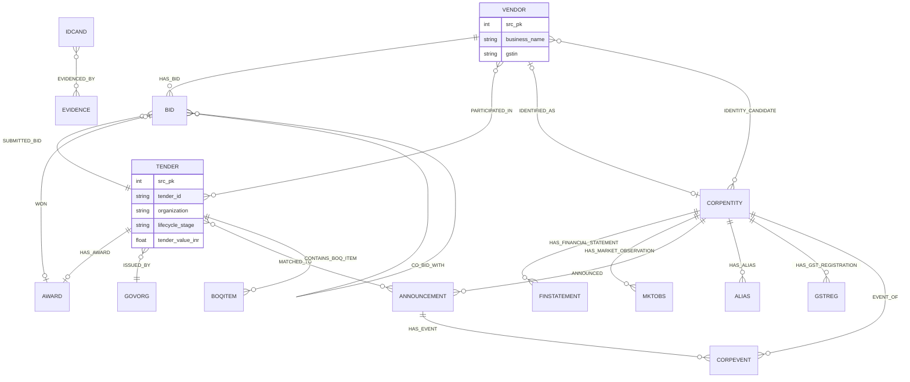

# GRAPH_ONTOLOGY.md — TenderGraph initial ontology (Phase 0)

Basis: live schema verified in DATABASE_AUDIT.md; HydraDB constraints verified in
HYDRADB_COMPATIBILITY.md (scalar property types only; `id` = upsert key = vertex identity;
labels mandatory for graph-wide queries; every relationship directed with exactly one type).

Design rule: **every source row that becomes graph content carries its source table + PK as
properties** (`src_table`, `src_pk`), and every relationship carries `src_table`, `src_pk`
(where row-based) or the join columns. No relationship is created from name similarity alone
— identity edges come only from the evidence model in §4.

## 1. Node definitions

Node `id` (the HydraDB vertex id) is a **non-negative integer derived deterministically from
the stable graph ID string** via a collision-resistant hash (64-bit, e.g. xxh64/FNV over the
`<type>:<key>` string), stored alongside the full string in the `gid` property. Rationale:
HydraDB `id` is an integer upsert key (`algo.*` procedures take integer vertex ids), while
auditable IDs must be human-readable strings.

GID format: `<TYPE>:<namespace>:<source pk or natural key>`.

| Label | GID | Source table → PK | Core properties (types) | Optional properties | Unique identity rule |
|---|---|---|---|---|---|
| `Tender` | `TENDER:v:` + `tenders.id` | `tenders` → `id int` | `gid str`, `src_pk int`, `tender_id str` (external), `organization str`, `lifecycle_stage str`, `website_url str`, `created_at_ms int` | `title str`, `category str`, `product_category str`, `ref_no str`, `published_at_ms int`, `bid_opening_at_ms int`, `bid_submission_end_ms int`, `tender_value_inr num`, `contract_type str`, `pincode str`, `location str`, `description str`, `emd_value num`, `updated_at_ms int` | One node per `tenders.id` (PK unique by definition) |
| `GovernmentOrganization` | `GOVORG:org:` + normalized(`organization`) | `tenders.organization` (string; no FK table exists) | `gid str`, `name str`, `norm_name str` | `website_url str` | one node per distinct normalized organization string (dedupe rule) |
| `Bid` | `BID:v:` + `tender_participants.id` | `tender_participants` → `id int` | `gid str`, `src_pk int`, `bid_number str`, `participant_name str`, `participant_normalized str`, `financial_rank str`, `financial_bid_value_inr num`, `is_winner bool`, `technical_status str`, `financial_status str`, `submitted_at_ms int` | `technical_remarks str`, `financial_remarks str`, `updated_at_ms int` | one node per participant row (unique `(tender_id, bid_number)`) |
| `Vendor` | `VENDOR:cp:` + `contractor_v2.id` | `contractor_v2` → `id int` | `gid str`, `src_pk int`, `business_name str`, `gstin str` | `legal_status str`, `address str`, `created_at_ms int` | one node per contractor row. **Not** merged with CorporateEntity. Separate `VENDOR:pn:<participant_normalized>` nodes are **not** created — unlinked participant names remain only on `Bid` nodes until an identity edge exists (avoids duplicate-company nodes from name variants) |
| `CorporateEntity` | `ENTITY:v:` + `entities.id` (uuid) | `entities` → `id uuid` | `gid str`, `src_pk uuid-str`, `canonical_name str`, `normalized_name str`, `ticker_nse str`, `ticker_bse str`, `is_listed bool`, `exchange_status str` | `sector str`, `industry str`, `exchange str`, `website str` (all NULL today — verified) | one node per `entities.id`; `isin` excluded until populated |
| `Award` | `AWARD:v:` + `tender_extracted_meta.id` | `tender_extracted_meta` → `id int` (1:1 with tender) | `gid str`, `src_pk int`, `awardee_name str`, `awardee_normalized str`, `awarded_value_inr num`, `winning_bid_number str`, `contract_date str` (ISO date) | `award_stage str` (`AOC_CONFIRMED` / `L1_SELECTED_AOC_PENDING` from view classification — see §7) | one node per extracted-meta row that has award evidence (awardee or winning_bid_number set); rows with no award evidence get no Award node |
| `IdentityCandidate` | `IDCAND:v:` + control-table id (`tg_identity_candidates.id`, new, additive) | `tg_identity_candidates` (Phase-1 control table) | `gid str`, `left_type str`, `left_gid str`, `right_gid str`, `status str` (`CANDIDATE`/`CONFIRMED`/`REJECTED`), `method str`, `score num` | `reviewed_by str`, `reviewed_at_ms int`, `notes str` | one node per candidate pair; mirrors `tender_announcement_matches` state machine precedent |
| `Evidence` | `EVID:v:` + evidence row id | `tg_evidence` (Phase-1 control table) or derived record | `gid str`, `kind str` (`NAME_EXACT`, `ALIAS`, `GSTIN_EXACT`, `BID_NUMBER_MATCH`, `AWARDEE_NAME_MATCH`, `GST_NAME`, `ANNOUNCEMENT`), `src_table str`, `src_pk str`, `created_at_ms int` | `weight num` | one node per evidence record; linked to both sides of an identity relationship |
| `FinancialStatement` | `FIN:v:` + `entity_financials.id` | `entity_financials` → `id bigint` | `gid str`, `src_pk int64-str`, `fiscal_year str` (incl. `TTM`), `revenue_crore num`, `ebitda_crore num`, `net_profit_crore num`, `net_worth_crore num`, `total_assets_crore num` | `equity_capital/reserves/borrowings/… num` (Rs crore), `source str`, `source_date str` | one node per `(entity_id, fiscal_year)` (DB unique constraint) |
| `MarketObservation` | `MKT:v:` + `entity_market_data.id` | `entity_market_data` → `id bigint` | `gid str`, `src_pk int64-str`, `snapshot_date str`, `market_cap_crore num`, `current_price num`, `shares_outstanding int` | — | one per `(entity_id, snapshot_date)` (DB unique constraint) |
| `CorporateAnnouncement` | `ANN:v:` + `announcements_raw.id` | `announcements_raw` → `id bigint` | `gid str`, `src_pk int64-str`, `seq_id str`, `title str`, `category str`, `company_name str`, `isin str`, `announcement_at_ms int`, `has_xbrl bool`, `source str` | `attachment_url str` | one per `announcements_raw.id`; entity link only via explicit relationship (42/148 rows lack `entity_id`) |
| `CorporateEvent` | `EVENT:v:` + `company_events.id` | `company_events` → `id bigint` | `gid str`, `src_pk int64-str`, `event_type str`, `event_subtype str`, `event_date str`, `importance_score int` | `extracted_data str` (JSON-serialized) | one per row; empty today, projection ships schema-ready |
| `BOQItem` | `BOQ:v:` + `boq_items.id` | `boq_items` → `id int` | `gid str`, `src_pk int`, `sl_no str`, `item_description str`, `quantity num`, `units str`, `rate_inr num`, `rrr_inr num`, `awardee_rate_inr num`, `awardee_amount_inr num` | — | one per `boq_items.id`; linked to tender via its `tender_file_id → tender_files.tender_id` chain (resolved at projection time) |
| `Alias` | `ALIAS:v:` + `entity_aliases.id` (uuid) | `entity_aliases` → `id uuid` | `gid str`, `src_pk uuid-str`, `alias_name str`, `normalized_alias str`, `source str` | — | one per row (DB unique `(entity_id, normalized_alias)`) |
| `GstRegistration` | `GST:v:` + `entity_gst.id` | `entity_gst` → `id bigint` | `gid str`, `src_pk int64-str`, `gstin str`, `company_name str`, `state str` | — | one per row (DB unique `(entity_id, gstin)`); distinct GSTINs of one company stay separate nodes (state-level registrations) |
| `Seller` (GeM) | `SELLER:sd:` + `seller_details.id` | `seller_details` → `id uuid` | `gid str`, `src_pk uuid-str`, `company_name str`, `gstin str`, `pan str`, `gem_seller_id str` | `msme_registration_number str`, `address str` | one per row; **GeM island — no identity merging with procurement vendors in Phase 1** |
| `Product` / `GemCategory` | `GEMCAT:code:` + `category_code` | `gem_categories` → `id int`, natural key `category_code` | `gid str`, `category_code str`, `category_name str` | — | one per `category_code` (DB unique). `Product` nodes deferred — `product_details` is empty |

Deliberately **not** created: `Location` (no source data — `location_meta` empty and
`tender_extracted_meta.location` is free text), `AnalystDecision` (modeled as
`IdentityCandidate` status + reviewer properties; a separate node adds no traversal value),
`TenderFile` (document pipeline, not relationship intelligence).

## 2. Relationship definitions

All relationships directed, single type (HydraDB constraint). Provenance properties on every
edge: `src_table str`, `src_pk str` (or `left_pk`/`right_pk` for derived edges), plus
`evidence_gid str` where identity-backed.

| Type | From → To | Source table/columns | Cardinality | Provenance |
|---|---|---|---|---|
| `ISSUED_BY` | `Tender` → `GovernmentOrganization` | `tenders.organization` (string match on norm) | N:1 | `src_table='tenders'`, `src_pk=tenders.id` |
| `HAS_EXTRACTED_META` — *avoided*: meta fields are folded into `Tender` and `Award` nodes (1:1 verified) | — | — | — | — |
| `PARTICIPATED_IN` | `Vendor` → `Tender` | `tenders.contractor_v2_id` | N:1 | src_table tenders, src_pk |
| `SUBMITTED_BID` | `Bid` → `Tender` | `tender_participants.tender_id` FK | N:1 | src_table tender_participants, src_pk |
| `WON` | `Bid` → `Award` | evidence: `winning_bid_number` = normalized `bid_number`, or `awardee_normalized` = `participant_normalized` (same priority as view's `winner_evidence`) | 0..1 per Bid | `evidence_gid`, `evidence_kind` |
| `HAS_AWARD` | `Tender` → `Award` | `tender_extracted_meta` row (1:1 tender) | 1:1 | src_table tender_extracted_meta, src_pk |
| `HAS_ALIAS` | `CorporateEntity` → `Alias` | `entity_aliases.entity_id` FK | 1:N | src_table entity_aliases, src_pk |
| `IDENTIFIED_AS` | `Vendor` or `Bid` → `CorporateEntity` | identity decisions (§4); dashboard mapping CTEs for confirmed name matches | 0..1 CONFIRMED per Vendor; N CANDIDATE | `status`, `method`, `confidence`, `evidence_gids` |
| `HAS_GST_REGISTRATION` | `CorporateEntity` → `GstRegistration` | `entity_gst.entity_id` FK | 1:N | src_table entity_gst, src_pk |
| `GST_LINKS` | `Vendor`/`GstRegistration` → `CorporateEntity` — see §4 rule R3 (GSTIN equality is candidate evidence, never auto-merge; 733 GSTINs span multiple entities — verified) | derived from `entity_gst.gstin` = `contractor_v2.gst` | M:N derived | `src_table`, `left_pk`, `right_pk`, `evidence_kind='GSTIN_EXACT'` |
| `HAS_FINANCIAL_STATEMENT` | `CorporateEntity` → `FinancialStatement` | `entity_financials.entity_id` FK | 1:N | src_table entity_financials, src_pk |
| `HAS_QUARTERLY_FINANCIALS` | `CorporateEntity` → `FinancialStatement` (quarter) | `entity_quarterly_financials` | 1:N | src_table + src_pk |
| `HAS_MARKET_OBSERVATION` | `CorporateEntity` → `MarketObservation` | `entity_market_data.entity_id` FK | 1:N | src_table + src_pk |
| `ANNOUNCED` | `CorporateEntity` → `CorporateAnnouncement` | `announcements_raw.entity_id` FK (nullable — only edges where set) | 1:N | src_table announcements_raw, src_pk |
| `HAS_EVENT` | `CorporateAnnouncement` → `CorporateEvent` | `company_events.announcement_id` FK | 1:N | src_table company_events, src_pk |
| `EVENT_OF` | `CorporateEvent` → `CorporateEntity` | `company_events.entity_id` FK (nullable) | N:1 | src_table + src_pk |
| `MATCHED_TO` | `Tender` → `CorporateAnnouncement` | `tender_announcement_matches` (`tender_id`, `announcement_id`), status `CANDIDATE/CONFIRMED/REJECTED` preserved on edge | N:M | `src_pk`, `match_status`, `match_method`, `reviewed_by` |
| `CONTAINS_BOQ_ITEM` | `Tender` → `BOQItem` | `boq_items → tender_files.tender_id` (chain, resolved) | 1:N | `src_table='boq_items'`, `src_pk`, `via_tender_file_pk` |
| `CO_BID_WITH` | `Bid` → `Bid` | derived: same `tender_id` (up to 85 participants/tender; cap fan-out per pair) | M:N derived | `src_table='tender_participants'`, `left_pk`, `right_pk`, `tender_pk` |
| `SELLS_VIA_CONTRACT` | `Seller` → `GeMCategory` / `Award`-analog `GemContract` | `seller_details.category → gem_categories.category_code`; contract value/dates as node props | N:1 | src_table seller_details, src_pk |

**Naming discipline** (business concepts never collapsed):
- `PARTICIPATED_IN` (contractor-level tender linkage, from `tenders.contractor_v2_id`) ≠
  `SUBMITTED_BID` (bid-level, from `tender_participants`) — different rows, different evidence.
- `WON` requires positive winner evidence (bid-number or awardee-name match, mirroring
  `vw_vyuha_l1_intelligence.winner_evidence`); `is_winner=true` alone maps to
  `evidence_kind='WINNER_FLAG_ONLY'` and is stored on the edge but yields a lower confidence.
- `HAS_AWARD` is structural (tender↔award record); `WON` is behavioral (bid↔award).
- `HAS_ALIAS` from `entity_aliases` is *never* conflated with `IDENTIFIED_AS`.

## 3. Stable ID conventions

1. `gid` string: `<TYPE>:<origin>:<key>`; origins `v` = source-table PK, `org:` = normalized
   natural key, `code:` = natural code key, control tables use their own PK.
2. Numeric vertex `id`: 63-bit hash of `gid` (collision check at ingestion; a collision
   aborts the batch — expected frequency negligible at ≤10⁶ nodes).
3. GIDs are immutable; a re-projected row MERGEs on the same id (HydraDB `id` upsert
   semantics verified).
4. Relationship identity: `id`/`src_pk` property on the edge + MERGE per edge where the
   source row is unique; batch dedupe on `(src,dst,type)` is only a safety net (HydraDB
   batch semantics verified).

## 4. Identity resolution rules (evidence-backed, never name-auto-merge)

State machine mirrors the existing `tender_announcement_matches` precedent:
`CANDIDATE → CONFIRMED | REJECTED`, reviewer + notes retained.

| Rule | Candidate | Evidence kind | Status |
|---|---|---|---|
| R1 | `Bid.participant_normalized` = `entities.normalized_name` | `NAME_EXACT` | auto `CANDIDATE`, high score; CONFIRM only via analyst or rule R1+R2 both hit |
| R2 | = `entity_aliases.normalized_alias` | `ALIAS` | CANDIDATE (high) |
| R3 | `contractor_v2.gstin` = `entity_gst.gstin` | `GSTIN_EXACT` | CANDIDATE — **never auto-CONFIRM**: 733 GSTINs map to >1 entity (verified) |
| R4 | normalized(`entity_gst.company_name`) matches | `GST_NAME` | CANDIDATE (secondary; never overrides R1/R2 — dashboard priority preserved) |
| R5 | Award side: `awardee_normalized` matches R1/R2/R4 | `AWARDEE_NAME_MATCH` | CANDIDATE |
| — | Rejected pairs keep the edge with `status='REJECTED'` (never deleted) so the negative decision is auditable | | |
| — | Multi-candidate at winning priority ⇒ keep all CANDIDATE edges, none CONFIRMED (dashboard `ambiguous` semantics preserved) | | |

Implementation note: confirmed mapping pairs currently computed by
`api/internal/repo/mapping.go` CTEs are re-used as the initial `IDENTIFIED_AS` seed; the
graph must reproduce the same `MATCHED / AMBIGUOUS / UNRESOLVED` partition (validated against
`vw_vyuha_l1_intelligence.entity_mapping_status`).

## 5. Temporal properties

- All timestamps stored as `*_ms` epoch-millis **integers** (HydraDB property values are
  int/float/bool/string only — verified); ISO strings in parallel `*_iso` display props where
  useful.
- Dates without timezone (`tender_extracted_meta.contract_date date`, `snapshot_date`,
  `quarter_end_date`, `event_date`) stored as ISO `YYYY-MM-DD` strings + `*_ms` int at
  00:00 UTC.
- Temporal fields on the entities that carry them natively: tender lifecycle dates on
  `Tender`; `contract_date` on `Award`; `announcement_time` on `CorporateAnnouncement`;
  `event_date` on `CorporateEvent`; `fiscal_year` (string, may be `TTM`) on
  `FinancialStatement`; `snapshot_date` on `MarketObservation`.
- Every node/edge carries `synced_at_ms` (projection watermark time) — distinct from source
  business time; no invented "valid from/to" intervals in Phase 0 (no source column exists).

## 6. Provenance model

- Nodes: `src_table`, `src_pk` mandatory. Derived nodes (`GovernmentOrganization`) store
  `origin='derived'` and the contributing source column.
- Edges: FK-backed edges store `src_table`/`src_pk` (the FK-carrying row). Derived edges
  (`WON`, `CO_BID_WITH`) store both endpoint PKs and the evidence kind. Identity edges store
  `status`, `method`, `evidence_gids` (list-as-JSON string).
- Rule: graph content with no PostgreSQL source is forbidden. Analyst decisions are the only
  graph-native facts and they live in `tg_identity_candidates` / `tg_evidence` (additive
  control tables in the authoritative DB), so even they retain PostgreSQL provenance.

## 7. Example graph structures

### Contract-to-capital (confirmed identity)
```
(Tender:TENDER:v:1042 {organization:"NHAI", tender_id:"2026_NHAI_1042", tender_value_inr:482000000})
  -[:ISSUED_BY]-> (GovernmentOrganization {name:"NHAI"})
  -[:HAS_AWARD]-> (Award:AWARD:v:9001 {awardee_normalized:"larsen and toubro", awarded_value_inr:441000000, contract_date:"2026-02-11"})
(Bid:BID:v:7781 {bid_number:"BID-33", participant_normalized:"larsen and toubro", financial_rank:"L1", financial_bid_value_inr:441000000, is_winner:true})
  -[:SUBMITTED_BID]-> (Tender)
  -[:WON {evidence_kind:"BID_NUMBER_MATCH"}]-> (Award)
(Vendor:VENDOR:cp:312 {business_name:"L&T Infra", gstin:"27AABCL5055K1Z9"})
  -[:IDENTIFIED_AS {status:"CONFIRMED", method:"name_exact+gstin", confidence:0.97}]->
(CorporateEntity:ENTITY:v:<uuid> {canonical_name:"Larsen & Toubro Ltd", ticker_nse:"LT"})
  -[:HAS_FINANCIAL_STATEMENT]-> (FinancialStatement {fiscal_year:"FY2026", revenue_crore:210000})
  -[:HAS_MARKET_OBSERVATION]-> (MarketObservation {snapshot_date:"2026-11-01", market_cap_crore:495000})
```

### Identity candidate flow (unconfirmed)
```
(Bid {participant_normalized:"alpha infra"})-[:SUBMITTED_BID]->(Tender)
(Vendor)-[:IDENTIFIED_AS {status:"CANDIDATE", method:"name_exact"}]->(CorporateEntity)
(IdentityCandidate {status:"CANDIDATE", method:"name_exact", score:0.8})
  -[:EVIDENCED_BY {evidence_kind:"NAME_EXACT", src_table:"tender_participants", src_pk:"7781"}]->(Evidence)
```

### Vendor network via CO_BID_WITH
```
(Bid {participant_normalized:"alpha infra"})-[:CO_BID_WITH {tender_pk:1042}]->(Bid {participant_normalized:"beta roads"})
```

## 8. Mermaid diagram



(Class `VENDOR--BID : HAS_BID` denotes `Bid.src` provenance rather than a separate edge in
the first iteration; the graph edge from Vendor to Bid is realized via
`IDENTIFIED_AS`+`SUBMITTED_BID` chains or, if needed in Phase 1, an explicit
`MADE_BID` edge. Kept explicit to avoid implicit joins.)
