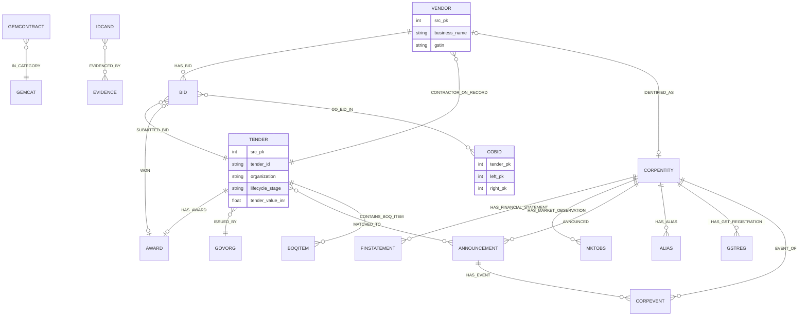

# GRAPH_ONTOLOGY.md — TenderGraph initial ontology (Phase 0)

Basis: live schema verified in DATABASE_AUDIT.md; HydraDB constraints verified in
HYDRADB_COMPATIBILITY.md (scalar property types only; `id` = upsert key = vertex identity;
labels mandatory for graph-wide queries; every relationship directed with exactly one type).

Design rule: **every source row that becomes graph content carries its source table + PK as
properties** (`src_table`, `src_pk`), and every relationship carries `src_table`, `src_pk`
(where row-based) or the join columns. No relationship is created from name similarity alone
— identity edges come only from the evidence model in §4.

## 1. Node definitions

Two distinct identity concepts (authoritative convention — see §3 and HYDRADB_COMPATIBILITY.md
§ID contract):

- **`gid`** — the *canonical application identity string* (`<TYPE>:<origin>:<key>`), stored as
  a string property on every node. This is the human-auditable, immutable identity.
- **`id`** — the *HydraDB vertex id*: a **non-negative integer** (the engine's documented
  id type — cypher-compat §Values: "Node ids are non-negative integers"; string ids are not
  documented and must not be assumed). It is derived deterministically from the **complete
  `gid` string** (type + origin + key, never just the source PK) by a versioned 63-bit hash.
  The GID string remains the canonical identity; the numeric id is a storage-level derived
  key and may change in a future hash-algorithm migration (see §3.1).

GID format: `<TYPE>:<origin>:<source pk or natural key>`.

| Label | GID | Source table → PK | Core properties (types) | Optional properties | Unique identity rule |
|---|---|---|---|---|---|
| `Tender` | `TENDER:v:` + `tenders.id` | `tenders` → `id int` | `gid str`, `src_pk int`, `tender_id str` (external), `organization str`, `lifecycle_stage str`, `website_url str`, `created_at_ms int` | `title str`, `category str`, `product_category str`, `ref_no str`, `published_at_ms int`, `bid_opening_at_ms int`, `bid_submission_end_ms int`, `tender_value_exact str`, `tender_value_inr num`, `contract_type str`, `pincode str`, `location str`, `description str`, `emd_value_exact str`, `emd_value num`, `updated_at_ms int` | One node per `tenders.id` (PK unique by definition) |
| `GovernmentOrganization` | `GOVORG:org:` + normalized(`organization`) | `tenders.organization` (string; no FK table exists) | `gid str`, `name str`, `norm_name str` | `website_url str` | one node per distinct normalized organization string (dedupe rule) |
| `Bid` | `BID:v:` + `tender_participants.id` | `tender_participants` → `id int` | `gid str`, `src_pk int`, `bid_number str`, `participant_name str`, `participant_normalized str`, `financial_rank str`, `financial_bid_value_exact str`, `financial_bid_value_inr num`, `is_winner bool`, `technical_status str`, `financial_status str`, `submitted_at_ms int` | `technical_remarks str`, `financial_remarks str`, `updated_at_ms int` | one node per participant row (unique `(tender_id, bid_number)`) |
| `Vendor` | `VENDOR:cp:` + `contractor_v2.id` | `contractor_v2` → `id int` | `gid str`, `src_pk int`, `business_name str`, `gstin str` | `legal_status str`, `address str`, `created_at_ms int` | one node per contractor row. **Not** merged with CorporateEntity. Separate `VENDOR:pn:<participant_normalized>` nodes are **not** created — unlinked participant names remain only on `Bid` nodes until an identity edge exists (avoids duplicate-company nodes from name variants) |
| `CorporateEntity` | `ENTITY:v:` + `entities.id` (uuid) | `entities` → `id uuid` | `gid str`, `src_pk uuid-str`, `canonical_name str`, `normalized_name str`, `ticker_nse str`, `ticker_bse str`, `is_listed bool`, `exchange_status str` | `sector str`, `industry str`, `exchange str`, `website str` (all NULL today — verified) | one node per `entities.id`; `isin` excluded until populated |
| `Award` | `AWARD:v:` + `tender_extracted_meta.id` | `tender_extracted_meta` → `id int` (1:1 with tender) | `gid str`, `src_pk int`, `awardee_name str`, `awardee_normalized str`, `awarded_value_exact str`, `awarded_value_inr num`, `winning_bid_number str`, `contract_date str` (ISO date) | `award_stage str` (`AOC_CONFIRMED` / `L1_SELECTED_AOC_PENDING` from view classification — see §7) | one node per extracted-meta row that has award evidence (awardee or winning_bid_number set); rows with no award evidence get no Award node |
| `IdentityCandidate` | `IDCAND:v:` + control-table id (`tg_identity_candidates.id`, new, additive) | `tg_identity_candidates` (Phase-1 control table) | `gid str`, `left_type str`, `left_gid str`, `right_gid str`, `status str` (`CANDIDATE`/`CONFIRMED`/`REJECTED`), `method str` (no numeric `score`/`confidence` property is stored — no evidence-justified threshold exists; see §4) | `reviewed_by str`, `reviewed_at_ms int`, `notes str` | one node per candidate pair; mirrors `tender_announcement_matches` state machine precedent |
| `Evidence` | `EVID:v:` + evidence row id | `tg_evidence` (Phase-1 control table) or derived record | `gid str`, `kind str` (`NAME_EXACT`, `ALIAS`, `GSTIN_EXACT`, `BID_NUMBER_MATCH`, `AWARDEE_NAME_MATCH`, `GST_NAME`, `ANNOUNCEMENT`), `src_table str`, `src_pk str`, `created_at_ms int` | `weight num` | one node per evidence record; linked to both sides of an identity relationship |
| `CoBidObservation` (derived) | `COBID:v:` + deterministic `<tender_pk>:<min_pk>:<max_pk>` of the two participant rows | derived from `tender_participants` (two rows sharing `tender_id`) | `gid str`, `tender_pk int`, `left_pk int`, `right_pk int`, `left_gid str`, `right_gid str`, `synced_at_ms int` | — | one observation per (tender, participant-pair); **canonical co-bid representation** — a direct `Bid→Bid` edge would be collapsed by HydraDB batch dedupe on `(src,dst,type)`, destroying per-tender evidence (§2, DECISIONS D12) |
| `FinancialStatement` | `FIN:v:` + `entity_financials.id` | `entity_financials` → `id bigint` | `gid str`, `src_pk int64-str`, `fiscal_year str` (incl. `TTM`), `revenue_exact str` + `revenue_crore num`, `ebitda_exact str` + `ebitda_crore num`, `net_profit_exact str` + `net_profit_crore num`, `net_worth_exact str` + `net_worth_crore num`, `total_assets_exact str` + `total_assets_crore num` | `equity_capital/reserves/borrowings/…` (`_exact str` + `_crore num`, Rs crore), `source str`, `source_date str` | one node per `(entity_id, fiscal_year)` (DB unique constraint) |
| `MarketObservation` | `MKT:v:` + `entity_market_data.id` | `entity_market_data` → `id bigint` | `gid str`, `src_pk int64-str`, `snapshot_date str`, `market_cap_exact str` + `market_cap_crore num` (Rs crore), `current_price_exact str` + `current_price num` (Rs/share), `shares_outstanding int` | — | one per `(entity_id, snapshot_date)` (DB unique constraint) |
| `CorporateAnnouncement` | `ANN:v:` + `announcements_raw.id` | `announcements_raw` → `id bigint` | `gid str`, `src_pk int64-str`, `seq_id str`, `title str`, `category str`, `company_name str`, `isin str`, `announcement_at_ms int`, `has_xbrl bool`, `source str` | `attachment_url str` | one per `announcements_raw.id`; entity link only via explicit relationship (42/148 rows lack `entity_id`) |
| `CorporateEvent` | `EVENT:v:` + `company_events.id` | `company_events` → `id bigint` | `gid str`, `src_pk int64-str`, `event_type str`, `event_subtype str`, `event_date str`, `importance_score int` | `extracted_data str` (JSON-serialized) | one per row; empty today, projection ships schema-ready |
| `BOQItem` | `BOQ:v:` + `boq_items.id` | `boq_items` → `id int` | `gid str`, `src_pk int`, `sl_no str`, `item_description str`, `quantity num`, `units str`, `rate_exact str`, `rate_inr num`, `rrr_exact str`, `rrr_inr num`, `awardee_rate_exact str`, `awardee_rate_inr num`, `awardee_amount_exact str`, `awardee_amount_inr num` | — | one per `boq_items.id`; linked to tender via its `tender_file_id → tender_files.tender_id` chain (resolved at projection time) |
| `Alias` | `ALIAS:v:` + `entity_aliases.id` (uuid) | `entity_aliases` → `id uuid` | `gid str`, `src_pk uuid-str`, `alias_name str`, `normalized_alias str`, `source str` | — | one per row (DB unique `(entity_id, normalized_alias)`) |
| `GstRegistration` | `GST:v:` + `entity_gst.id` | `entity_gst` → `id bigint` | `gid str`, `src_pk int64-str`, `gstin str`, `company_name str`, `state str` | — | one per row (DB unique `(entity_id, gstin)`); distinct GSTINs of one company stay separate nodes (state-level registrations) |
| `GemContract` (GeM) | `GEMC:v:` + `seller_details.id` | `seller_details` → `id uuid` | `gid str`, `src_pk uuid-str`, `contract_no str` (business dedup key — DB-unique constraint verified) | seller attribute snapshot kept on the contract: `seller_company_name str`, `seller_gstin str`, `seller_pan str`, `gem_seller_id str`, `msme_registration_number str`, `address str` — **all seller identity fields verified empty in live data (0 non-null of 4,078 rows)**, so they are normally omitted per the null rule | one node per row; **no separate `Seller` nodes in the baseline** — a contract row is not a seller identity; **GeM island — no identity merging with procurement vendors in Phase 1** (DECISIONS D11) |
| `Product` / `GemCategory` | `GEMCAT:code:` + `category_code` | `gem_categories` → `id int`, natural key `category_code` | `gid str`, `category_code str`, `category_name str` | — | one per `category_code` (DB unique). `Product` nodes deferred — `product_details` is empty |

**Monetary property policy** (DATA_MAPPING §Conventions, DECISIONS D13): every monetary
field is stored twice — `<field>_exact str`, the canonical **exact decimal string**
preserving source precision (varchar-parsed procurement values interpreted in **rupees**;
`numeric(20,2)` financial/market values interpreted in **Rs crore**), plus a float analytics
copy (`_inr` / `_crore` / bare `num`). Floats are never claimed exact; exact arithmetic stays
in PostgreSQL or Go decimal code. Units are explicit per field and never silently converted.

Deliberately **not** created: `Location` (no source data — `location_meta` empty and
`tender_extracted_meta.location` is free text), `AnalystDecision` (modeled as
`IdentityCandidate` status + reviewer properties; a separate node adds no traversal value),
`TenderFile` (document pipeline, not relationship intelligence).

## 2. Relationship definitions

All relationships directed, single type (HydraDB constraint). Provenance properties on every
edge: `src_table str`, `src_pk str` (or `left_pk`/`right_pk` for derived edges), plus
`evidence_gid str` where identity-backed.

| Type | From → To | Source table/columns | Cardinality | Provenance |
|---|---|---|---|---|
| `ISSUED_BY` | `Tender` → `GovernmentOrganization` | `tenders.organization` (string match on norm) | N:1 | `src_table='tenders'`, `src_pk=tenders.id` |
| `HAS_EXTRACTED_META` — *avoided*: meta fields are folded into `Tender` and `Award` nodes (1:1 verified) | — | — | — | — |
| `CONTRACTOR_ON_RECORD` | `Vendor` → `Tender` | `tenders.contractor_v2_id` → `contractor_v2.id`. Meaning: the tender row names this contractor of record — **assignment only; it does not prove bid participation, bid submission, or winning** (renamed from the earlier `PARTICIPATED_IN`, which overstated the source — DECISIONS D10) | N:1 (0..1 per tender; nullable) | `src_table='tenders'`, `src_pk=tenders.id` |
| `SUBMITTED_BID` | `Bid` → `Tender` | `tender_participants.tender_id` FK | N:1 | src_table tender_participants, src_pk |
| `WON` | `Bid` → `Award` | evidence: `winning_bid_number` = normalized `bid_number`, or `awardee_normalized` = `participant_normalized` (same priority as view's `winner_evidence`) | 0..1 per Bid | `evidence_gid`, `evidence_kind` |
| `HAS_AWARD` | `Tender` → `Award` | `tender_extracted_meta` row (1:1 tender) | 1:1 | src_table tender_extracted_meta, src_pk |
| `HAS_ALIAS` | `CorporateEntity` → `Alias` | `entity_aliases.entity_id` FK | 1:N | src_table entity_aliases, src_pk |
| `IDENTIFIED_AS` | `Vendor` or `Bid` → `CorporateEntity` | identity decisions (§4); dashboard mapping CTEs for confirmed name matches | 0..1 CONFIRMED per Vendor; N CANDIDATE | `status`, `method`, `evidence_gids` (no `confidence` — §4) |
| `HAS_GST_REGISTRATION` | `CorporateEntity` → `GstRegistration` | `entity_gst.entity_id` FK | 1:N | src_table entity_gst, src_pk |
| `GST_LINKS` | `Vendor`/`GstRegistration` → `CorporateEntity` — see §4 rule R3 (GSTIN equality is candidate evidence, never auto-merge; 733 GSTINs span multiple entities — verified) | derived from `entity_gst.gstin` = `contractor_v2.gst` | M:N derived | `src_table`, `left_pk`, `right_pk`, `evidence_kind='GSTIN_EXACT'` |
| `HAS_FINANCIAL_STATEMENT` | `CorporateEntity` → `FinancialStatement` | `entity_financials.entity_id` FK | 1:N | src_table entity_financials, src_pk |
| `HAS_QUARTERLY_FINANCIALS` | `CorporateEntity` → `FinancialStatement` (quarter) | `entity_quarterly_financials` | 1:N | src_table + src_pk |
| `HAS_MARKET_OBSERVATION` | `CorporateEntity` → `MarketObservation` | `entity_market_data.entity_id` FK | 1:N | src_table + src_pk |
| `ANNOUNCED` | `CorporateEntity` → `CorporateAnnouncement` | `announcements_raw.entity_id` FK (nullable — only edges where set) | 1:N | src_table announcements_raw, src_pk |
| `HAS_EVENT` | `CorporateAnnouncement` → `CorporateEvent` | `company_events.announcement_id` FK | 1:N | src_table company_events, src_pk |
| `EVENT_OF` | `CorporateEvent` → `CorporateEntity` | `company_events.entity_id` FK (nullable) | N:1 | src_table + src_pk |
| `MATCHED_TO` | `Tender` → `CorporateAnnouncement` | `tender_announcement_matches` (`tender_id`, `announcement_id`), status `CANDIDATE/CONFIRMED/REJECTED` preserved on edge | N:M | `src_pk`, `match_status`, `match_method`, `reviewed_by` |
| `CONTAINS_BOQ_ITEM` | `Tender` → `BOQItem` | `boq_items → tender_files.tender_id` (chain, resolved) | 1:N | `src_table='boq_items'`, `src_pk`, `via_tender_file_pk` |
| `CO_BID_IN` | `Bid` → `CoBidObservation` (one edge from **each** of the two participant Bids; 2 edges per observation) | derived: two `tender_participants` rows sharing `tender_id` (up to 85 participants/tender; one observation per tender per pair) | 2 per observation | `src_table='tender_participants'`, `src_pk` = participant row pk; the observation node carries `tender_pk`, `left_pk`, `right_pk` |
| `IN_CATEGORY` | `GemContract` → `GemCategory` | `seller_details.category` FK → `gem_categories.category_code` | N:1 | `src_table='seller_details'`, `src_pk`. No `SELLS_VIA_CONTRACT` edge and no `Seller` node in the baseline — seller attributes stay on the contract (DECISIONS D11); no edge connects GeM to the procurement tender domain |

**Naming discipline** (business concepts never collapsed):
- `CONTRACTOR_ON_RECORD` (assignment named on the tender row, `tenders.contractor_v2_id`) ≠
  `SUBMITTED_BID` (bid participation, from `tender_participants.tender_id`). A contractor
  assignment is **never** bid participation and **never** winner evidence; bidder-network
  analysis derives only from actual `tender_participants` rows plus supported identity links.
- Co-bidding is modeled as `CoBidObservation` nodes with `CO_BID_IN` edges, never as a
  `Bid→Bid` aggregated edge — one observation per (tender, pair) preserves the evidence a
  `(src,dst,type)` batch dedupe would collapse (DECISIONS D12). A co-bid pattern is a
  statistical observation only; it is **never** labeled collusion without independent evidence.
- GeM: a `seller_details` row is a **contract**, not a seller identity — `GemContract` only in
  the baseline (DECISIONS D11); sellers are never merged on GSTIN or name equality.
- `WON` requires positive winner evidence (bid-number or awardee-name match, mirroring
  `vw_vyuha_l1_intelligence.winner_evidence`); `is_winner=true` alone is weaker evidence
  (`evidence_kind='WINNER_FLAG_ONLY'`, recorded on the edge) and **never establishes `WON`
  by itself**. A `CONTRACTOR_ON_RECORD` assignment never becomes winner evidence.
- `HAS_AWARD` is structural (tender↔award record); `WON` is behavioral (bid↔award).
- `HAS_ALIAS` from `entity_aliases` is *never* conflated with `IDENTIFIED_AS`.

## 3. Stable ID conventions

1. **`gid` string** (canonical application identity, immutable): `<TYPE>:<origin>:<key>`;
   origins `v` = source-table PK, `org:` = normalized natural key, `code:` = natural code
   key, control tables use their own PK. The gid always encodes the **complete** identity
   (type + origin + full key) — a hash input is never the bare source PK.
2. **Numeric vertex `id`** (HydraDB identity; storage-level derived key): a **versioned
   63-bit hash of the complete `gid` string** — input is the UTF-8 byte sequence of the full
   gid; output interpreted as unsigned and masked to 63 bits so the value is a non-negative
   signed-64-bit integer (HydraDB node ids are non-negative integers — verified). The exact
   algorithm (candidate: an xxh64 variant) and its version constant are fixed at
   implementation time in Phase 1; **the hash function is not implemented in Phase 0**.
   - **Collision detection (mandatory)**: before a batch MERGE on `id`, the projector must
     verify that any existing node at that `id` carries the same `gid`. A mismatch aborts
     the batch and the pair is logged in a `tg_id_collisions`-style additive control table;
     resolution is a versioned re-key (a hash-version bump re-namespaces the numeric ids),
     **never a silent merge**. Two source entities must never share a numeric id.
   - **Versioning**: nodes carry `id_algo_v int`. A future hash migration re-derives ids and
     re-upserts them by batch with `gid` unchanged — the gid stays the canonical identity
     even if the numeric id changes.
   - Expected collision frequency at ≤10⁶ nodes is negligible, but the detection path is
     required regardless of the probability.
3. **Re-projection idempotency**: a re-projected row re-derives the same `gid` → the same
   numeric `id` → MERGE/upsert on `id` (HydraDB `id`-as-upsert-key semantics verified).
4. **Relationship identity**: HydraDB documents batch edge creation
   (`UNWIND $rows AS row CREATE (a {id: row.src})-[:T]->(b {id: row.dst})`) and a batch
   dedupe on `(src, dst, type)`; MERGE-by-`id`-property on relationships appears only in
   batch form and its uniqueness semantics are **under-specified — not assumed**. HydraDB
   provides no documented relationship-uniqueness constraint. Therefore:
   - Row-based edges (one per source row) are safe: replay re-creates the same
     `(src, dst, type)` set and the documented batch dedupe collapses duplicate retries
     harmlessly.
   - **Multi-observation facts are modeled as nodes** (`CoBidObservation`), because a
     `(src, dst, type)` batch dedupe would collapse multiple legitimate observations into a
     single edge.
   - Application-level idempotency (deterministic gid → deterministic edge-key sets,
     checkpointed replay-safe batches) is the dedup mechanism; idempotency is *not* delegated
     to HydraDB relationship constraints.

## 4. Identity resolution rules (evidence-backed; analyst-confirmed; never auto-merged)

State machine mirrors the existing `tender_announcement_matches` precedent:
`CANDIDATE → CONFIRMED | REJECTED`, reviewer + notes retained. **All status transitions are
analyst actions** — no rule in Phase 0/1 automatically CONFIRMs a candidate (DECISIONS D6).
Rules only create `CANDIDATE` edges with evidence:

| Rule | Candidate | Evidence kind | Status |
|---|---|---|---|
| R1 | `Bid.participant_normalized` = `entities.normalized_name` (exact normalized legal-name match) | `NAME_EXACT` | auto `CANDIDATE` |
| R2 | = `entity_aliases.normalized_alias` (exact normalized alias match) | `ALIAS` | auto `CANDIDATE` |
| R3 | `contractor_v2.gstin` = `entity_gst.gstin` (exact GSTIN match) | `GSTIN_EXACT` | auto `CANDIDATE` — **never auto-CONFIRM, and never eligible as the second confirming rule in any dual-rule scheme: 733 GSTINs map to >1 entity (verified)** |
| R4 | normalized(`entity_gst.company_name`) exact-normalized match (secondary signal) | `GST_NAME` | auto `CANDIDATE` (never overrides R1/R2 — dashboard priority preserved) |
| R5 | Award side: `awardee_normalized` matches R1/R2/R4 patterns | `AWARDEE_NAME_MATCH` | auto `CANDIDATE` (award-side signal, kept distinct from bid-side rules) |
| — | Rejected pairs keep the edge with `status='REJECTED'` (never deleted) so the negative decision is auditable | | |
| — | Multi-candidate at the same matching priority ⇒ keep all CANDIDATE edges, none CONFIRMED (dashboard `ambiguous` semantics preserved) | | |

### 4.1 Permitted state transitions

| Transition | Who | Mechanism |
|---|---|---|
| (none) → `CANDIDATE` | Automatic | Rule R1–R5 fires during projection; candidate row + evidence written to `tg_identity_candidates` / `tg_evidence` |
| `CANDIDATE` → `CONFIRMED` | **Analyst only** | Explicit analyst decision; `reviewed_by` + `reviewed_at` recorded; the `IDENTIFIED_AS` edge status flips |
| `CANDIDATE` → `REJECTED` | **Analyst only** | Explicit analyst decision; the edge is kept with `status='REJECTED'` (never deleted) |
| `REJECTED` → re-review | Analyst only | Never silently converted back. New evidence opens a **new** `CANDIDATE` referencing the prior rejection; the old REJECTED row remains |
| New evidence on a CANDIDATE | Automatic | Additional `Evidence` records attach to the existing candidate; status unchanged |

- **Automatic confirmation: none.** No rule combination (including R1+R2) auto-confirms in
  Phase 0/1. If a future automatic-confirmation rule is proposed, it must be justified by
  verified evidence and must not use GSTIN equality as sufficient confirmation.
- **No invented scores or thresholds**: no numeric confidence is computed or stored; rule
  priority (R1 > R2 > R3-evidence > R4 > R5) mirrors the dashboard mapping order and is a
  documentation convention, not a threshold.
- **Multi-candidate ambiguity**: multiple candidate entities at the same matching priority ⇒
  all remain `CANDIDATE`, none `CONFIRMED`.
- **One confirmed entity per vendor (business invariant)**: multiple confirmed corporate
  entities for one vendor are prohibited. HydraDB enforces no uniqueness constraints — the
  invariant must be enforced by an authoritative PostgreSQL control-table constraint (e.g. a
  partial unique index on confirmed pairs per left gid in `tg_identity_candidates`) or an
  application-level transaction. **Design only — not implemented in Phase 0.**
- **Conflicting analyst decisions**: resolved by latest `reviewed_at`; full decision history
  is retained for audit.
- **Dashboard semantics unchanged**: mapping computed by `api/internal/repo/mapping.go` CTEs
  is presentation-time and independent of graph status. Dashboard `MATCHED` is **not** graph
  `CONFIRMED` — no auto-confirmation (DECISIONS D6). The graph must reproduce the same
  `MATCHED / AMBIGUOUS / UNRESOLVED` partition (validated against
  `vw_vyuha_l1_intelligence.entity_mapping_status`).

## 5. Temporal properties

- All timestamps stored as `*_ms` epoch-millis **integers** (HydraDB property values are
  int/float/bool/string only — verified); ISO strings in parallel `*_iso` display props where
  useful.
- Dates without timezone (`tender_extracted_meta.contract_date date`, `snapshot_date`,
  `quarter_end_date`, `event_date`) stored as ISO `YYYY-MM-DD` strings + `*_ms` int at
  00:00 UTC.
- Temporal fields on the entities that carry them natively: tender lifecycle dates on
  `Tender`; `contract_date` on `Award`; `announcement_time` on `CorporateAnnouncement`;
  `event_date` on `CorporateEvent`; `fiscal_year` (string, may be `TTM`) on
  `FinancialStatement`; `snapshot_date` on `MarketObservation`.
- Every node/edge carries `synced_at_ms` (projection watermark time) — distinct from source
  business time; no invented "valid from/to" intervals in Phase 0 (no source column exists).

## 6. Provenance model

- Nodes: `src_table`, `src_pk` mandatory. Derived nodes (`GovernmentOrganization`) store
  `origin='derived'` and the contributing source column.
- Edges: FK-backed edges store `src_table`/`src_pk` (the FK-carrying row). Derived edges
  (`WON`) store both endpoint PKs and the evidence kind. Co-bid evidence lives on
  `CoBidObservation` nodes (§2) — not on a pair-edge. Identity edges store
  `status`, `method`, `evidence_gids` (list-as-JSON string).
- Rule: graph content with no PostgreSQL source is forbidden. Analyst decisions are the only
  graph-native facts and they live in `tg_identity_candidates` / `tg_evidence` (additive
  control tables in the authoritative DB), so even they retain PostgreSQL provenance.

## 7. Example graph structures

### Contract-to-capital (confirmed identity)
```
(Tender {id: 812405516704231, gid:"TENDER:v:1042", organization:"NHAI",
         tender_id:"2026_NHAI_1042", tender_value_exact:"482000000.00", tender_value_inr:482000000.0})
  -[:ISSUED_BY]-> (GovernmentOrganization {name:"NHAI"})
  -[:HAS_AWARD]-> (Award {gid:"AWARD:v:9001", awardee_normalized:"larsen and toubro",
         awarded_value_exact:"441000000.00", awarded_value_inr:441000000.0, contract_date:"2026-02-11"})
(Bid {gid:"BID:v:7781", bid_number:"BID-33", participant_normalized:"larsen and toubro",
      financial_rank:"L1", financial_bid_value_exact:"441000000.00", is_winner:true})
  -[:SUBMITTED_BID]-> (Tender)
  -[:WON {evidence_kind:"BID_NUMBER_MATCH"}]-> (Award)
(Vendor {gid:"VENDOR:cp:312", business_name:"L&T Infra", gstin:"27AABCL5055K1Z9"})
  -[:IDENTIFIED_AS {status:"CONFIRMED", method:"name_exact"}]->
(CorporateEntity {gid:"ENTITY:v:<uuid>", canonical_name:"Larsen & Toubro Ltd", ticker_nse:"LT"})
  -[:HAS_FINANCIAL_STATEMENT]-> (FinancialStatement {fiscal_year:"FY2026",
         revenue_exact:"210000.00", revenue_crore:210000.0})
  -[:HAS_MARKET_OBSERVATION]-> (MarketObservation {snapshot_date:"2026-11-01", market_cap_crore:495000.0})
```
(`id` values shown are illustrative, not production hashes. CONFIRMED here means an analyst
has confirmed the candidate — it is never rule-automatic.)

### Identity candidate flow (unconfirmed)
```
(Bid {gid:"BID:v:7790", participant_normalized:"alpha infra"})-[:SUBMITTED_BID]->(Tender)
(Vendor {gid:"VENDOR:cp:318"})-[:IDENTIFIED_AS {status:"CANDIDATE", method:"name_exact"}]->
  (CorporateEntity {gid:"ENTITY:v:<uuid2>"})
(IdentityCandidate {gid:"IDCAND:v:51", status:"CANDIDATE", method:"name_exact"})
  -[:EVIDENCED_BY {evidence_kind:"NAME_EXACT", src_table:"tender_participants", src_pk:"7790"}]->(Evidence)
```

### Vendor network via CoBidObservation
```
(Bid {gid:"BID:v:7781"})-[:CO_BID_IN]->(CoBidObservation {gid:"COBID:v:1042:7781:7803",
      tender_pk:1042, left_pk:7781, right_pk:7803})<-[:CO_BID_IN]-(Bid {gid:"BID:v:7803"})
```
One observation node per (tender, pair): A and B sharing 12 tenders produce **12**
`CoBidObservation` nodes, each linked from both Bids — the per-tender evidence survives
batch replay and dedupe. Traversal:
`MATCH (b1:Bid)-[:CO_BID_IN]->(o)<-[:CO_BID_IN]-(b2:Bid)` counts distinct observations per pair.

### GeM (island domain)
```
(GemContract {gid:"GEMC:v:<uuid>", contract_no:"GEM/2026/B/12345"})
  -[:IN_CATEGORY]->(GemCategory {category_code:"51141600"})
```
Seller attribute properties are omitted (all verified empty in live data); no edge links
`GemContract` to the procurement tender domain.

## 8. Mermaid diagram



(Class `VENDOR--BID : HAS_BID` denotes `Bid.src` provenance rather than a separate edge in
the first iteration; the graph edge from Vendor to Bid is realized via
`IDENTIFIED_AS`+`SUBMITTED_BID` chains or, if needed in Phase 1, an explicit
`MADE_BID` edge. Kept explicit to avoid implicit joins.)
